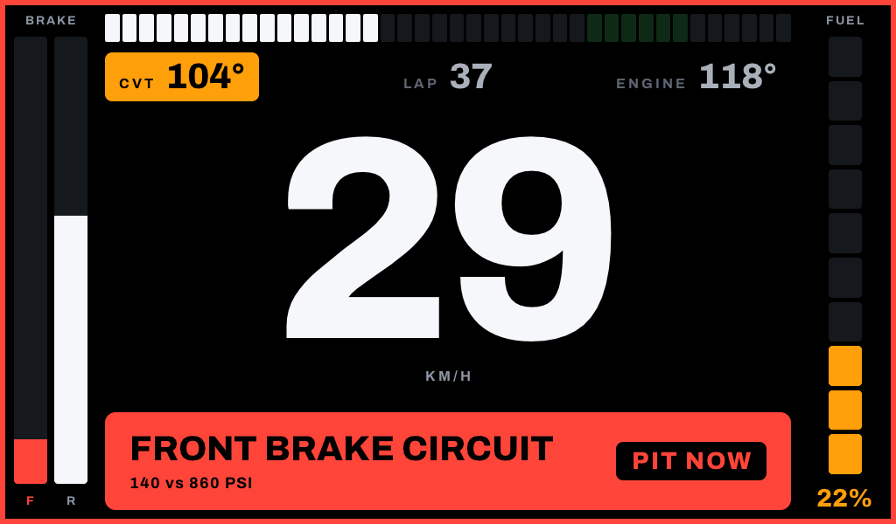

# Driver display

A screen in the cockpit that shows the driver live values from the car's CAN bus: speed, engine RPM, and warnings such as low brake pressure or low fuel.

**Status:** the screens are drawn, but nothing reads CAN yet. The program shows the driver view with hardcoded values taken from the designs. The [components](docs/COMPONENTS.md) for the driver and workshop views are ready to be fed with live data.



Read the [project introduction](../README.md) first if you are new to the DAQ, and the [CAN protocol](../docs/PROTOCOL.md) for what each frame means.

## Hardware

| Part | What we have | Notes |
|---|---|---|
| Computer | Raspberry Pi 3 Model B+ | Specs and current state: [Raspberry Pi status](docs/RASPBERRY_PI.md) |
| Screen | 7-inch IPS, 1024 × 600, full-size HDMI, micro-USB power, no touch | RTD2660 controller. Brightness, power draw and sealing are unknown |
| CAN | MCP2515 module, connected over SPI | **Not usable as is**: 8 MHz crystal and 5 V transceiver. See [module check](#check-the-mcp2515-module-before-wiring) |

The display only listens to the bus. It should keep working whether or not the master is recording.

## What the driver sees

From the first research document:

- **Driver view**, shown automatically at startup: large speed in km/h, numeric engine RPM, a simple RPM bar and warnings.
- **Workshop views**: live values, short trends and CAN diagnostics.
- **One paddle** behind the steering wheel: a long press switches between driver and workshop modes, and a short press cycles workshop views.
- Missing data is shown as unavailable, never as an old or zero value.

## Reusing the existing CAN code

| Code | Reusable? | Why |
|---|---|---|
| [`protocol/app_protocol.h`](../protocol/app_protocol.h) | **Yes, as is** | It only needs `stdint.h` and `stdbool.h`. CAN IDs, the bitrate and frame layouts stay shared with the firmware |
| `master-node/src/can/can_master.c`, `sensor-node/src/can/can_node.c` | No | Built on Espressif's TWAI driver and FreeRTOS, which do not exist on Linux |

On the Pi, the Linux `mcp251x` driver and SocketCAN replace that driver code. The program gets frames from a socket and decodes them using the shared header.

The header can only be included from C or C++, so this setup uses C. A Python version would need its own copy of the IDs. Graphics use [LVGL](https://lvgl.io), the library named in the research, through its Linux DRM driver.

## Where each value comes from

| Display value | CAN signal | Status |
|---|---|---|
| Engine RPM | `0x0BB` | Ready, while nodes are sampling |
| Brake pressure | `0x0B1` front, `0x0B2` rear, in psi | Ready, while nodes are sampling. The "low" threshold is not defined |
| Speed | None yet | **Open**, see below |
| Low fuel | None | **Open**, see below |

## Open problems

1. **Nodes are silent unless the master is recording.** Sensor nodes only send samples after START, and the master sends STOP when it boots. Until the firmware changes, the display has no live values outside a recording. This needs a change on the nodes and master.
2. **Speed is not on the bus.** GPS speed (`0x700`) stays inside the master and is never sent on CAN. The options are for the master to send it, or to calculate speed from the gearbox bearing RPM (`0x0B9`) using the drivetrain ratios.
3. **There is no fuel signal.** The DAQ has no fuel sensor. Low fuel needs a sensor first, possibly through the generic ADC node (`0x0BA`).
4. **Power reliability.** The team has seen the Pi reset during supply drops in real use. The research document says to move to the ESP32-P4 if reliable operation cannot be established quickly, so test this early.

## Check the MCP2515 module before wiring

Our current module has an **8 MHz crystal**, an **NXP TJA1050 transceiver** (marked `A1050/C`) and a single `VCC` pin, read from a photo of the board. It needs replacing or modifying before it can join the bus. These points come from the MCP2515 and Pi specifications and have not been tested on the bus.

- **Crystal:** the bus runs at 1 Mbit/s, which an 8 MHz crystal cannot reach. 12 MHz or 16 MHz works.
- **Voltage:** the Pi's GPIO pins are 3.3 V and are not 5 V tolerant. The TJA1050 needs about 5 V, and with a single `VCC` pin the MCP2515 shares that supply, so its outputs can damage the Pi. Any replacement module needs 3.3 V logic.
- **Termination:** the bus is already terminated at both ends. Remove the module's 120 Ω jumper unless the display is at the end of the bus. On our module this looks like `J1`, next to the `121` resistor.
- **Listen-only mode:** use it first, so the display cannot disturb the DAQ.
- **Frame loss:** the bus carries roughly 1000 frames per second and the MCP2515 has only two receive buffers. Measure drops on the bench with `ip -s -d link show can0`.

## Code layout

| Path | What it is |
|---|---|
| [`src/ui/`](src/ui) | The component library: RPM bar, brake bars, fuel gauge, alerts, trends... See [Components](docs/COMPONENTS.md) |
| [`src/views/driver_view.c`](src/views/driver_view.c) | The driver view layout, as in the designs |
| [`src/views/demo_screens.c`](src/views/demo_screens.c) | The designs and the workshop views, filled with hardcoded values |
| [`src/main.c`](src/main.c) | The driver display program |
| [`src/gallery.c`](src/gallery.c) | Shows every demo screen in turn, to check them on the panel |
| [`src/snapshot.c`](src/snapshot.c) | Renders the demo screens to PNG files on a laptop |
| [`src/display_poc.c`](src/display_poc.c) | The first screen test: "BAJA 2026" and a red border |

The CAN reader will include the shared [`protocol/app_protocol.h`](../protocol/app_protocol.h). Nothing uses it yet.

## Check the screens on a laptop

No Pi needed. On macOS or Linux, with a C compiler, `make`, `git` and zlib:

```bash
./deploy.sh --fetch-only   # downloads LVGL into third_party/, which git ignores
make snapshots
```

The PNG files land in `build/snapshots/`. The first build compiles LVGL, which takes about a minute.

## Run on the Pi

The Pi has no internet, so build from a laptop that does:

```bash
./deploy.sh
```

It downloads LVGL and the libdrm headers into `third_party/`, copies the project to `~/driver-display` on the Pi and builds there. The first build takes about 4 minutes, and later ones only recompile what changed.

Plug in and power the screen, then run one of these:

| Command | Shows |
|---|---|
| `ssh -t baja ./driver-display/build/driver-display` | The driver view, as design 1. Add `2` or `3` for the other designs |
| `ssh -t baja ./driver-display/build/gallery` | Every demo screen, 4 seconds each. Add a number to change the delay |
| `ssh -t baja ./driver-display/build/display-poc` | "BAJA 2026" and a red border, to check the picture fits the panel |

Press Ctrl+C to stop. Only one program can use the screen at a time.

## Start at power-up

On the Pi, from `~/driver-display`. Both commands ask for the Pi's password:

```bash
make autostart-on    # start the driver display at every power-up, and now
make autostart-off   # stop it and remove it from startup
```

`autostart-on` installs a systemd service, `driver-display`, which runs `build/driver-display` and restarts it if it stops. While it runs, stop it with `sudo systemctl stop driver-display` before starting another program on the screen. After a new `./deploy.sh`, restart it with `sudo systemctl restart driver-display`.

## Research

The first research compared the Pi with the ESP32-P4 and preferred the P4 with LVGL. The team chose the Pi because the Pi, screen and CAN module are already available.
