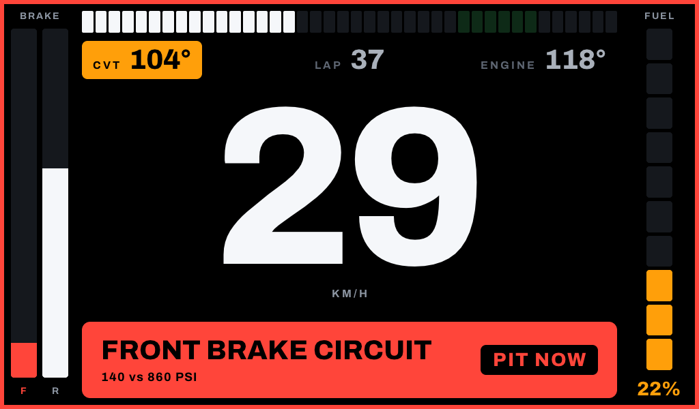

# Driver display

A screen in the cockpit that shows the driver live values from the car's CAN bus: speed, engine RPM, and warnings such as low brake pressure or low fuel.

**Status:** the screens are drawn and the CAN reader works, but the screens don't use it yet. The program still shows the driver view with hardcoded values taken from the designs. The CAN reader decodes everything on the bus and [`can-monitor`](#read-the-can-bus) shows it in a terminal; feeding the [components](docs/COMPONENTS.md) from it is the next step.



Read the [project introduction](../README.md) first if you are new to the DAQ, and the [CAN protocol](../docs/PROTOCOL.md) for what each frame means.

## Hardware

| Part | What we have | Notes |
|---|---|---|
| Computer | Raspberry Pi 3 Model B+ | Specs and current state: [Raspberry Pi status](docs/RASPBERRY_PI.md) |
| Screen | 7-inch IPS, 1024 × 600, full-size HDMI, micro-USB power, no touch | RTD2660 controller. Brightness, power draw and sealing are unknown |
| CAN | MCP2515 module, connected over SPI, powered from 3.3 V | Works on the bench. **Needs a 16 MHz crystal** for the car's 1 Mbit/s bus. See [the CAN module](hardware/can-module/README.md) |

The display only listens to the bus. It should keep working whether or not the master is recording.

## What the driver sees

From the first research document:

- **Driver view**, shown automatically at startup: large speed in km/h, numeric engine RPM, a simple RPM bar and warnings.
- **Workshop views**: live values, short trends and CAN diagnostics.
- **One paddle** behind the steering wheel: a long press switches between driver and workshop modes, and a short press cycles workshop views.
- Missing data is shown as unavailable, never as an old or zero value.

## Reusing the existing CAN code

| Code | Reusable? | Why |
|---|---|---|
| [`protocol/app_protocol.h`](../protocol/app_protocol.h) | **Yes, as is** | It only needs `stdint.h` and `stdbool.h`. CAN IDs, the bitrate and frame layouts stay shared with the firmware |
| `master-node/src/can/can_master.c`, `sensor-node/src/can/can_node.c` | No | Built on Espressif's TWAI driver and FreeRTOS, which do not exist on Linux |

On the Pi, the Linux `mcp251x` driver and SocketCAN replace that driver code. [`src/can/`](src/can) gets frames from a socket and decodes them using the shared header.

The header can only be included from C or C++, so this setup uses C. A Python version would need its own copy of the IDs. Graphics use [LVGL](https://lvgl.io), the library named in the research, through its Linux DRM driver.

## Where each value comes from

| Display value | CAN signal | Status |
|---|---|---|
| Engine RPM | `0x0BB` | Ready: nodes send all the time, recording or not |
| Brake pressure | `0x0B1` front, `0x0B2` rear, in psi | Ready. The "low" threshold is not defined |
| Speed | None yet | **Open**, see below |
| Low fuel | None | **Open**, see below |

## Open problems

1. ~~**Nodes are silent unless the master is recording.**~~ Solved: nodes now sample and send from boot, with or without a master, and Start/Stop only controls the SD log. Flash the master and every node from the same commit.
2. **Speed is not on the bus.** GPS speed (`0x700`) stays inside the master and is never sent on CAN. The options are for the master to send it, or to calculate speed from the gearbox bearing RPM (`0x0B9`) using the drivetrain ratios.
3. **There is no fuel signal.** The DAQ has no fuel sensor. Low fuel needs a sensor first, possibly through the generic ADC node (`0x0BA`).
4. **The Pi may drop frames under full DAQ load.** Known, not fixed yet: the MCP2515 has two receive buffers and is read over SPI at 1 MHz, while the bus can deliver a frame every 130 µs. `can-monitor` shows the Pi's own losses separately from node problems. Fixes for later: a faster `spimaxfrequency` (up to 10 MHz), or a controller with a deeper buffer such as an MCP2518FD HAT. See [the CAN module](hardware/can-module/README.md#limitations).
5. **Power reliability.** The team has seen the Pi reset during supply drops in real use. The research document says to move to the ESP32-P4 if reliable operation cannot be established quickly, so test this early.

## The CAN module

The MCP2515 module is wired to the Pi and passes every bench check: SPI, interrupt, internal loopback and the transceiver. Wiring, measurements and its limits are in [the CAN module README](hardware/can-module/README.md).

- **Crystal:** it has an 8 MHz crystal, which tops out at 800 kbit/s. The bus runs at 1 Mbit/s, so it needs a **16 MHz crystal** and `oscillator=16000000` in `/boot/firmware/config.txt` before it can join the car.
- **Voltage:** it runs from the Pi's 3.3 V, so its outputs are safe for the Pi without dividers. Never move its `VCC` to 5 V without the dividers.
- **Termination:** the bus is already terminated at both ends. Remove the module's 120 Ω jumper `J1` on the car; keep it on the bench, where nothing else terminates the bus.
- **Listen-only:** `make can-on` brings `can0` up listen-only, so the display cannot disturb the DAQ.

## Code layout

| Path | What it is |
|---|---|
| [`src/ui/`](src/ui) | The component library: RPM bar, brake bars, fuel gauge, alerts, trends... See [Components](docs/COMPONENTS.md) |
| [`src/views/driver_view.c`](src/views/driver_view.c) | The driver view layout, as in the designs |
| [`src/views/demo_screens.c`](src/views/demo_screens.c) | The designs and the workshop views, filled with hardcoded values |
| [`src/main.c`](src/main.c) | The driver display program |
| [`src/gallery.c`](src/gallery.c) | Shows every demo screen in turn, to check them on the panel |
| [`src/snapshot.c`](src/snapshot.c) | Renders the demo screens to PNG files on a laptop |
| [`src/display_poc.c`](src/display_poc.c) | The first screen test: "BAJA 2026" and a red border |
| [`src/can/`](src/can) | The CAN reader: `daq_decode` decodes every DAQ frame with the shared [`protocol/app_protocol.h`](../protocol/app_protocol.h), `daq_state` keeps the live table (latest value, rate and age per signal, each node's state and health), `can_socket` reads SocketCAN (Linux only) |
| [`src/can_monitor.c`](src/can_monitor.c) | `can-monitor`: the live table in a terminal |
| [`tests/test_daq.c`](tests/test_daq.c) | Host tests of the decoder and the live table: `make test` |
| [`tools/daq_sim.py`](tools/daq_sim.py) | Pretends to be the DAQ on a virtual bus: replays a recording or sends fake values |
| [`tools/can_check.py`](tools/can_check.py) | Bench check of the CAN module: SPI, interrupt, loopback, transceiver |

## Check the screens on a laptop

No Pi needed. On macOS or Linux, with a C compiler, `make`, `git` and zlib:

```bash
./deploy.sh --fetch-only   # downloads LVGL into third_party/, which git ignores
make snapshots
```

The PNG files land in `build/snapshots/`. The first build compiles LVGL, which takes about a minute.

## Run on the Pi

The Pi has no internet, so build from a laptop that does:

```bash
./deploy.sh
```

It downloads LVGL and the libdrm headers into `third_party/`, copies the project to `~/driver-display` on the Pi and builds there. The first build takes about 4 minutes, and later ones only recompile what changed.

Plug in and power the screen, then run one of these:

| Command | Shows |
|---|---|
| `ssh -t baja ./driver-display/build/driver-display` | The driver view, as design 1. Add `2` or `3` for the other designs |
| `ssh -t baja ./driver-display/build/gallery` | Every demo screen, 4 seconds each. Add a number to change the delay |
| `ssh -t baja ./driver-display/build/display-poc` | "BAJA 2026" and a red border, to check the picture fits the panel |

Press Ctrl+C to stop. Only one program can use the screen at a time.

## Read the CAN bus

`can-monitor` shows everything on the bus, refreshed every second: the Pi's own losses, the master's beacon and recording state, each node's state, health, error counters and events, and each signal's value, rate and age. A value that stopped arriving shows `NO DATA` after 0.5 s, and a node with no frame for 3 s shows `OFFLINE`.

```bash
make can-on                         # on the Pi, once: can0 listen-only at 1 Mbit/s at every power-up
make can-on BITRATE=500000          # with the 8 MHz crystal, on the bench
./build/can-monitor                 # Ctrl+C to stop
./build/can-monitor can0 --raw      # one line per frame instead, for a log file
make can-off                        # stop bringing can0 up at power-up
```

Without the car, make a virtual bus and let `tools/daq_sim.py` pretend to be the DAQ. It only transmits on `vcan*` interfaces, so it can never put fake frames on the car's bus:

```bash
sudo modprobe vcan && sudo ip link add vcan0 type vcan && sudo ip link set vcan0 up
python3 tools/daq_sim.py vcan0 &                         # fake but plausible values at the real rates
python3 tools/daq_sim.py vcan0 --replay log_0001.bin &   # or a recording copied from the SD card
./build/can-monitor vcan0
```

`--no-master` leaves out the beacon, and `--stop-node 4 --after 10` silences node 4 after 10 s, to check what the display does when data stops.

Tests that need no Pi: `make test` for the decoder and the live table, and `python3 -m unittest discover -s tools -p 'test_*.py'` for the generator.

## Start at power-up

On the Pi, from `~/driver-display`. Both commands ask for the Pi's password:

```bash
make autostart-on    # start the driver display at every power-up, and now
make autostart-off   # stop it and remove it from startup
```

`autostart-on` installs a systemd service, `driver-display`, which runs `build/driver-display` and restarts it if it stops. While it runs, stop it with `sudo systemctl stop driver-display` before starting another program on the screen. After a new `./deploy.sh`, restart it with `sudo systemctl restart driver-display`.

## Research

The first research compared the Pi with the ESP32-P4 and preferred the P4 with LVGL. The team chose the Pi because the Pi, screen and CAN module are already available.
