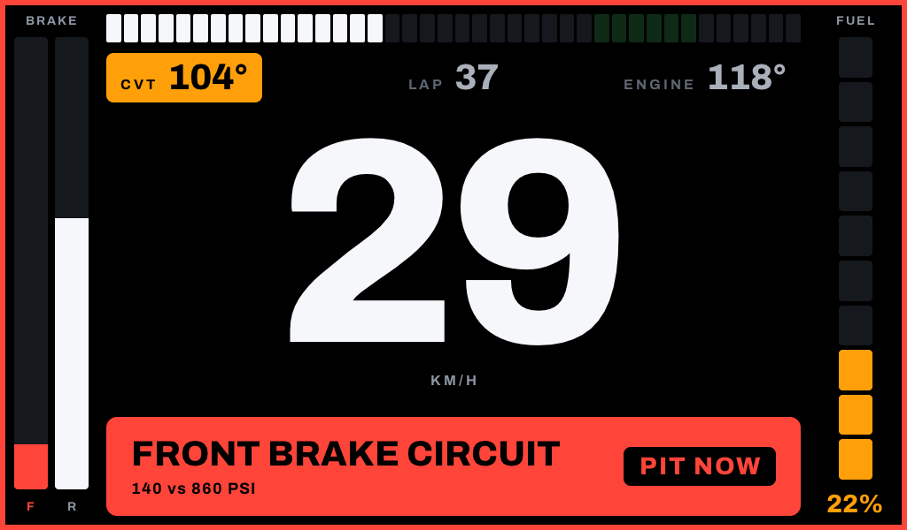
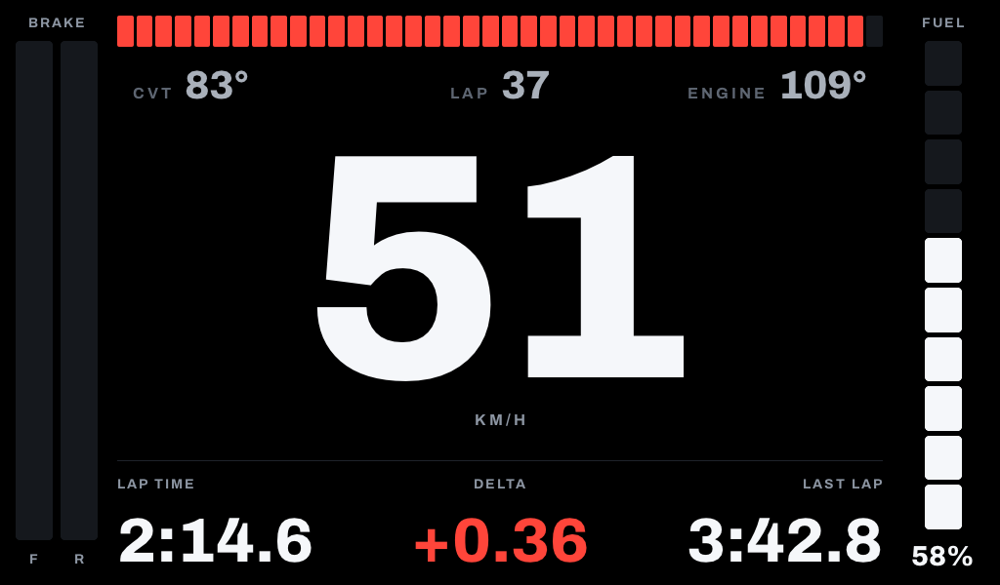
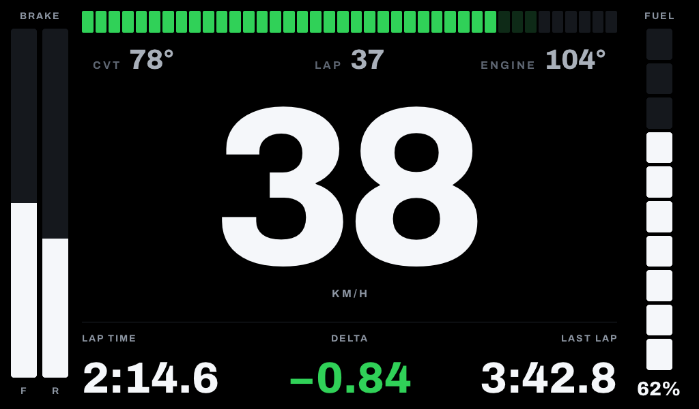
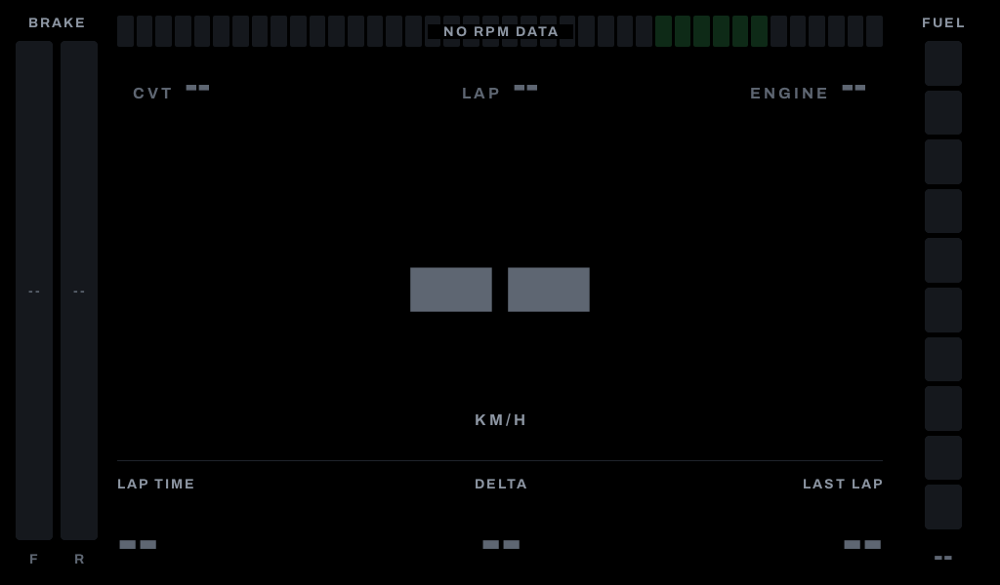
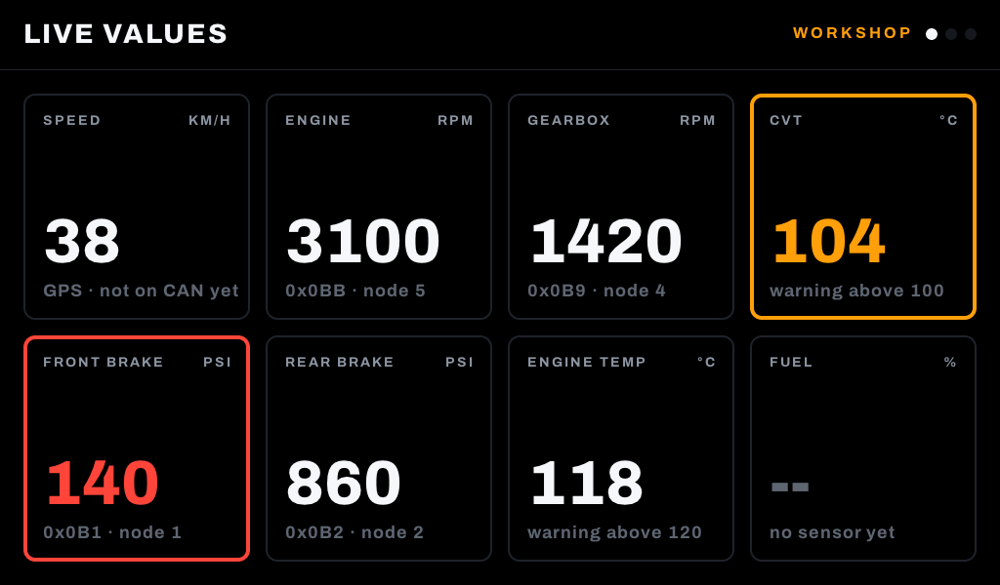
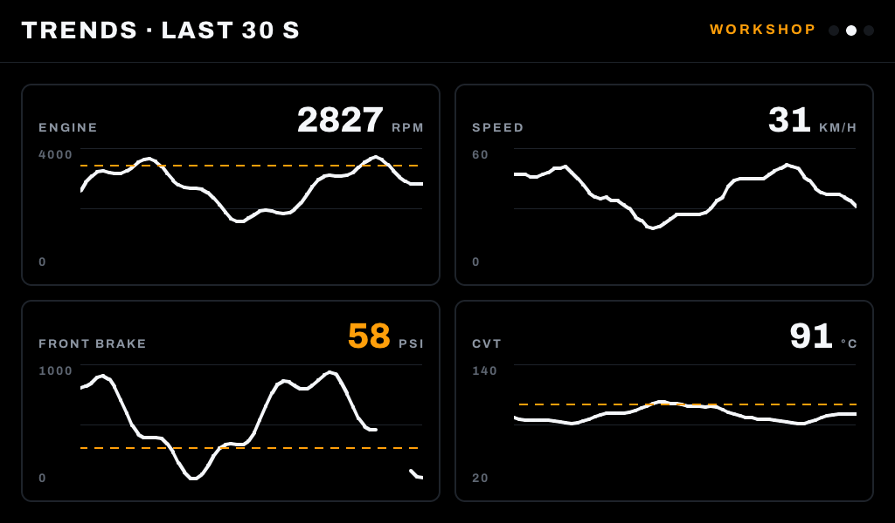
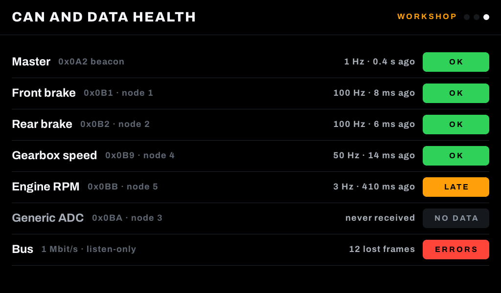

# Components

The building blocks of the driver and workshop views, in [`src/ui/`](../src/ui). They only draw: none of them reads CAN or handles the paddle. Include [`ui/dd_ui.h`](../src/ui/dd_ui.h) and call `dd_theme_init()` once after `lv_init()`.

The screenshots below come from `make snapshots`, which renders the [demo screens](../src/views/demo_screens.c) on a laptop. They are not photos of the panel.

## Design rules

All components follow these rules, so the views stay consistent:

- **Black background, bright text.** Values are near-white `#F5F7FA` on pure black, for sunlight and quick glances.
- **One colour per meaning.** Green means good (shift window, faster lap). Amber means it needs attention soon. Red means act now. Nothing else uses these colours.
- **Levels, not colours.** Components take a `dd_level_t` (`NORMAL`, `GOOD`, `WARNING`, `CRITICAL`) and pick the colour themselves.
- **Missing data is explicit.** Every component has a `..._set_unavailable()` function that shows `--` in dim grey. It never keeps an old value or shows 0. All components start unavailable.
- **One typeface.** Archivo, in the text styles of `dd_text_t`. Numbers use ExtraBold.

The colours and text styles are in [`dd_theme.h`](../src/ui/dd_theme.h).

## Driver view



| Component | Use in the design | Main functions |
|---|---|---|
| `dd_rpm_bar` | Segmented RPM bar at the top. White, green in the shift window, red from the limit | `_create(parent, &config)`, `_set_rpm`, `_set_unavailable` |
| `dd_bar_group` | Front and rear brake bars on the left | `_create(parent, "BRAKE", 2, captions)`, `_set_value(group, i, percent, level)`, `_set_unavailable(group, i)` |
| `dd_segment_gauge` | Fuel gauge on the right. Amber and red below its thresholds | `_create(parent, &config)`, `_set_percent`, `_set_unavailable` |
| `dd_readout` | CVT, LAP and ENGINE. Becomes an amber or red pill at warning or critical level | `_create(parent, "CVT")`, `_set_int(r, 104, "°")`, `_set_level`, `_set_unavailable` |
| `dd_hero_value` | The speed and its unit | `_create(parent, "KM/H")`, `_set_int`, `_set_unavailable` |
| `dd_stat` | LAP TIME, DELTA, LAST LAP | `_create(parent, "DELTA", align)`, `_set_text(s, text, level)`, `_set_unavailable` |
| `dd_alert_banner` | Red or amber banner with an instruction such as PIT NOW | `_create`, `_show(b, level, title, detail, action)`, `_hide` |
| `dd_segment_bar` | The base of the RPM bar and the fuel gauge, for other segmented bars | `_create(parent, count, direction)`, `_set_lit`, `_set_zone`, `_set_shape` |
| `dd_screen_*` (theme) | Black screen, and the coloured frame around it during an alert | `dd_screen_create`, `dd_screen_set_alert` |
| `dd_format_*` | Lap time `2:14.6` and delta `+0.36` / `−0.84` | `dd_format_lap_time`, `dd_format_delta`, `dd_delta_level` |

The layout itself is [`src/views/driver_view.c`](../src/views/driver_view.c). It places the components at the positions measured on the designs, and it swaps the lap stats for the banner during an alert.

| Design 2: RPM at the limit | Design 3: shift window | No data on the bus |
|---|---|---|
|  |  |  |

## Workshop views

The research asks for live values, short trends and CAN and data-health diagnostics. There is no design for these yet, so they reuse the driver view's colours and type. The values shown are made up.

| Component | Use | Main functions |
|---|---|---|
| `dd_header` | View title, mode and one dot per view | `_create(parent, "LIVE VALUES", "WORKSHOP")`, `_set_page(h, index, count)` |
| `dd_value_tile` | One live value with its unit and a note such as the CAN ID. Its frame turns amber or red | `_create(parent, caption, unit)`, `_set_int` / `_set_text`, `_set_note`, `_set_unavailable` |
| `dd_trend` | Line graph of recent values, with an optional dashed threshold. Gaps where data was missing | `_create(parent, &config)`, `_push(t, value, level)`, `_push_unavailable` |
| `dd_status_list` | Rows with a name, an ID, a detail and a status badge | `_create`, `_add(list, name, id)`, `_set(list, row, level, status, detail)` |

| Live values | Trends | CAN and data health |
|---|---|---|
|  |  |  |

## Example

```c
#include "ui/dd_ui.h"

lv_obj_t *screen = dd_screen_create();

lv_obj_t *speed = dd_hero_value_create(screen, "KM/H");
lv_obj_align(speed, LV_ALIGN_CENTER, 0, 0);
dd_hero_value_set_int(speed, 38);

lv_obj_t *cvt = dd_readout_create(screen, "CVT");
lv_obj_align(cvt, LV_ALIGN_TOP_LEFT, 120, 60);
dd_readout_set_int(cvt, 104, "°");
dd_readout_set_level(cvt, DD_LEVEL_WARNING);

lv_screen_load(screen);
```

## Adding a component

1. Create `src/ui/dd_<name>.h` and `.c`. Build it from `dd_box_create()` and `dd_text_create()`, and keep its state with `dd_state_create()`.
2. Take a `dd_level_t` rather than a colour, and add a `_set_unavailable()` function.
3. Add the header to `dd_ui.h`, use the component in a demo screen and check it with `make snapshots`.

## Fonts

The fonts are built into the program from Archivo (SIL Open Font License, [`src/ui/fonts/OFL.txt`](../src/ui/fonts/OFL.txt)), cut down to ASCII and `° · – −`. LVGL's Tiny TTF draws them at any size. To add a character, edit and run [`tools/make_fonts.sh`](../tools/make_fonts.sh).
