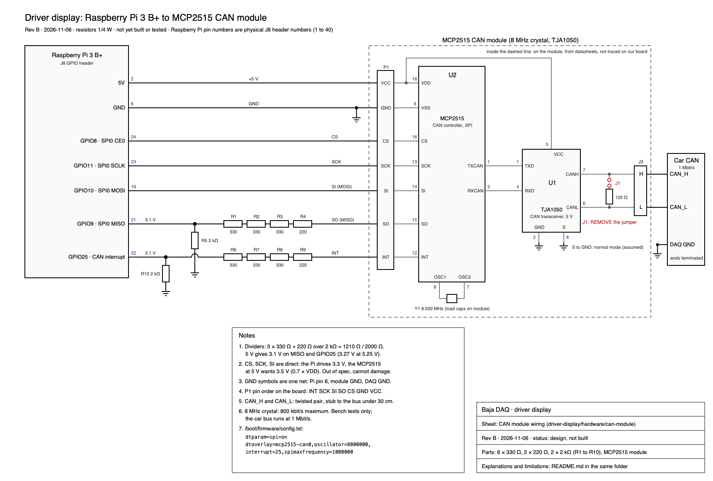

# CAN module wiring

How to connect our MCP2515 CAN module to the Raspberry Pi with resistors only, why the circuit looks like this, and what it cannot do.

**Status:** wired on the bench on 3.3 V without the dividers, and every bench check passes (see [Current state on the Pi](#current-state-on-the-pi)). The wiring is for **bench tests**: the module's 8 MHz crystal cannot run the car's 1 Mbit/s bus (see [Limitations](#limitations)).



The source is [`schematic.svg`](schematic.svg). The PNG is a render of it.

## Connections

Raspberry Pi pins are **physical** J8 header numbers (1 to 40). Some pinout diagrams use WiringPi numbers instead, where "GPIO 25" is a different pin.

| Raspberry Pi pin | Signal | Through | Module pin |
|---|---|---|---|
| 2 | 5 V | wire | VCC |
| 6 | GND | wire | GND |
| 24 | GPIO 8, SPI0 CE0 | wire | CS |
| 23 | GPIO 11, SPI0 SCLK | wire | SCK |
| 19 | GPIO 10, SPI0 MOSI | wire | SI |
| 21 | GPIO 9, SPI0 MISO | divider R1 to R5 | SO |
| 22 | GPIO 25, interrupt | divider R6 to R10 | INT |

Each divider has three 330 Ω and one 220 Ω in series between the module pin and the Pi pin, then one 2 kΩ from the Pi pin to ground:

```
module SO  ──[R1 330]──[R2 330]──[R3 330]──[R4 220]──┬── Pi pin 21
                                                     │
                                                 [R5 2 kΩ]
                                                     │
                                                    GND

module INT ──[R6 330]──[R7 330]──[R8 330]──[R9 220]──┬── Pi pin 22
                                                     │
                                                [R10 2 kΩ]
                                                     │
                                                    GND
```

On the car side, the module's screw terminal `J3` goes to the bus: `H` to CAN_H and `L` to CAN_L, as a twisted pair, with the branch to the bus under about 30 cm. The Pi's ground must be shared with the DAQ ground. **Remove jumper `J1`**: it adds a 120 Ω terminator, and the bus is already terminated at both ends.

The module header, in its order on the board: `INT SCK SI SO CS GND VCC`.

## Parts

| Part | Quantity |
|---|---|
| 330 Ω resistor, 1/4 W | 6 (R1 to R3, R6 to R8) |
| 220 Ω resistor, 1/4 W | 2 (R4, R9) |
| 2 kΩ resistor, 1/4 W | 2 (R5, R10) |
| MCP2515 module with TJA1050 and 8 MHz crystal | 1 |
| Raspberry Pi 3 B+ | 1 |

## Why this circuit

### Only two lines need protecting

The module runs at 5 V because its TJA1050 transceiver needs 4.75 to 5.25 V. The MCP2515 controller shares that supply, so its outputs swing to 5 V. The Pi's GPIO pins work at 3.3 V and are not 5 V tolerant.

| Line | Direction | Problem | Fix |
|---|---|---|---|
| SO, INT | module → Pi | The MCP2515 drives them to at least VDD − 0.5 V (SO) and VDD − 0.7 V (INT), so 4.3 to 5 V into the Pi | Divider to bring them under 3.3 V |
| CS, SCK, SI | Pi → module | The MCP2515 at 5 V needs 0.7 × VDD = 3.5 V to read a 1. The Pi gives 3.3 V | None. See below |

### The dividers

A divider can only lower a voltage, which is what SO and INT need. The top is 3 × 330 Ω + 220 Ω = 1210 Ω, the bottom 2 kΩ, so the output is 2000 / 3210 = 0.62 of the module's supply:

| Module supply | Divider output |
|---|---|
| 4.75 V | 2.96 V |
| 5.00 V | 3.12 V |
| 5.25 V | 3.27 V |

The output stays under 3.3 V even at the top of the 5 V tolerance. The Pi's 5 V pin often sits around 5.1 V.

The three 330 Ω stand in for a 1 kΩ (990 Ω), and the 220 Ω lowers the ratio below 2/3. Each divider draws about 1.6 mA from its output (5 V / 3210 Ω). Options we rejected:
- **1 kΩ / 2 kΩ** gives 3.33 V, and up to 3.5 V when the supply is high. That is above what the Pi accepts.
- **2 × 330 Ω over 3 × 330 Ω** uses only 330 Ω resistors, but draws 3 mA. The MCP2515 datasheet only guarantees the SO high level at 0.4 mA and INT at 1 mA. More current lowers the high level further.
- **4 × 330 Ω over 6 × 330 Ω** draws 1.5 mA, but needs 20 resistors.

The total resistance (3.2 kΩ) is low enough that the dividers do not slow the SPI signal noticeably at 1 MHz.

### CS, SCK and SI are wired directly

Raising 3.3 V to 5 V needs an active part, either a transistor or a buffer. Without one, the Pi's 3.3 V is 0.2 V below the MCP2515's 3.5 V minimum. This **cannot damage anything**: 3.3 V is well inside what a 5 V chip accepts. The only risk is that the module misreads the Pi, which would show as SPI errors or the driver failing to find the chip. These modules usually work this way, but the datasheet does not guarantee it.

If the module is unreliable, add a level shifter on these three lines only: a 74HCT125 buffer powered from 5 V, or one small-signal N-MOSFET per line (BSS138 or 2N7000) with 10 kΩ pull-ups on both sides. The dividers stay as they are.

### Why not the P85NF55 MOSFETs we have

The P85NF55 is a power MOSFET (60 V, 120 A). Its datasheet gives:
- **Gate threshold of 2 to 4 V.** In a level shifter, its gate only sees 3.3 V, so some parts would never turn on.
- **Input capacitance of 6650 pF** and output capacitance of 570 pF. With pull-up resistors, that limits SPI to tens of kHz, against the 1 MHz we want.

Putting several in parallel adds their capacitance and does not change the threshold.

### SPI at 1 MHz

The MCP2515 accepts up to 10 MHz. 1 MHz leaves margin for the divider and the long wires, and is still fast enough to read the frames. Raise it later if the bench test is clean.

## Before connecting to the Pi

Check the dividers with a multimeter before the first connection to pins 21 and 22. A wiring mistake there sends 5 V into the Pi.

1. Connect only VCC and GND of the module to a 5 V supply, or to Pi pins 2 and 6, with pins 21 and 22 **not** connected.
2. Measure between ground and the INT divider's output, where it would meet pin 22. INT stays high when idle, so expect **about 3.1 V**. Anything above 3.3 V means a wiring error.
3. The SO divider's output reads about 0 V: SO is switched off while CS is not active, and the bottom resistors pull it down. That is normal.

## Bench test

Add to `/boot/firmware/config.txt`, then reboot:

```text
dtparam=spi=on
dtoverlay=mcp2515-can0,oscillator=8000000,interrupt=25,spimaxfrequency=1000000
```

`oscillator` must match the crystal (8 MHz here) and `interrupt` is the BCM GPIO number (25 = physical pin 22).

Then check the module and run a loopback test, which needs no other CAN device. The Pi needs internet once to install `can-utils`. See [Raspberry Pi status](../../docs/RASPBERRY_PI.md).

```bash
dmesg | grep -i mcp251x          # expect: "MCP2515 successfully initialized"
sudo apt install can-utils
sudo ip link set can0 up type can bitrate 500000 loopback on
candump can0 &
cansend can0 123#DEADBEEF         # the frame should appear in candump
```

If `dmesg` reports that the MCP2515 was not found, check the SPI wiring first, then suspect the 3.3 V levels on CS, SCK and SI.

### Check script

[`tools/can_check.py`](../../tools/can_check.py) runs the whole bench test without `can-utils`. It needs only Python 3 and `ip`:

```bash
scp driver-display/tools/can_check.py baja@baja.local:
ssh -t baja@baja.local 'sudo python3 can_check.py'
```

| Step | What it checks |
|---|---|
| 1. Setup | `config.txt` lines, `spi0.0` bound to `mcp251x`, `dmesg`, `can0`, crystal setting |
| 2. Loopback | The MCP2515 sends 9 frames to itself and every byte must come back. Proves SPI, the crystal and INT. The transceiver is not used |
| 3. Listen | Listen-only for 5 s at 1 Mbit/s, or 500 kbit/s if the crystal cannot do 1 Mbit/s. Prints `NO DATA` when the bus is silent, otherwise decodes the DAQ frames |
| 4. Transceiver | Sends one frame at 125 kbit/s. With no other node, ERROR-PASSIVE means the transceiver works and BUS-OFF means it does not. Keep J1 fitted on the bench. Skipped if step 3 heard traffic |

Step 4 transmits, so it runs only with `--tx`, on a bench bus. It is also skipped when step 3 heard traffic or had to fall back to another bitrate. Never use `--tx` on the car. The script leaves `can0` down.

## Current state on the Pi

Applied on 2026-11-27. The Pi's clock read 2026-10-03, since it has no battery-backed clock.

### Wiring as built

It differs from the schematic:

| Item | Schematic | As built |
|---|---|---|
| Module VCC | Pi pin 2 (5 V) | Pi pin 1 (3.3 V) |
| SO and INT | Through dividers R1 to R10 | Direct, no resistors |
| Crystal | 8 MHz | 8 MHz, marked `8000` |

With VCC on 3.3 V, the module's outputs stay at 3.3 V, so dropping the dividers is safe for the Pi. **Do not move VCC to pin 2 without putting the dividers back**: SO and INT would then put 5 V on GPIO 9 and GPIO 25. A TJA1050 transceiver is specified for 4.75 to 5.25 V, so if the module uses one, step 4 of the check may fail at 3.3 V.

### Changes made on the Pi

| Change | Where | How to undo |
|---|---|---|
| Uncommented `dtparam=spi=on` (SPI0 on, creates `/dev/spidev0.1` for CE1) | `/boot/firmware/config.txt`, line 8 | Comment it out again |
| Added `dtoverlay=mcp2515-can0,oscillator=8000000,interrupt=25,spimaxfrequency=1000000` under `[all]` | `/boot/firmware/config.txt`, last line | Delete the line |
| One empty line before that overlay line, from a failed command | `/boot/firmware/config.txt` | Harmless |
| Backup taken before adding the overlay (SPI already on) | `/boot/firmware/config.txt.bak-can` | Delete the file |
| Copied the check script | `/home/baja/can_check.py` | Delete the file |
| Rebooted twice so the changes apply | | |

Nothing else is installed or enabled: no `can-utils`, no service, and no other packages. During diagnosis, `spi0.0` was briefly bound to `spidev`, GPIO pulls were changed, and pins 2, 3, 7 and 8 were driven by hand to talk to the chip. All of it was put back, and a reboot clears it in any case.

### First result: the wires followed WiringPi numbers

At boot the driver does not find the chip:

```text
mcp251x spi0.0: MCP251x didn't enter in conf mode after reset
mcp251x spi0.0: Probe failed, err=110
```

The module works. It was found on other pins:
- **INT:** with every free GPIO pulled low, only GPIO 26 stayed high. INT is on GPIO 26.
- **SPI:** talking to the chip by hand on GPIO 2, 7, 8 and 3 (CS, SCK, SI, SO) returned `CANSTAT=0x80` and `CANCTRL=0x87`, the correct values after a reset. The schematic's pins returned `0x00`.

Those are the schematic's GPIO numbers read as **WiringPi** numbers. The schematic and the README use BCM numbers.

| Module pin | Schematic: physical pin (BCM GPIO) | First wiring: physical pin (BCM GPIO) | WiringPi number |
|---|---|---|---|
| CS | 24 (GPIO 8) | 3 (GPIO 2) | 8 |
| SCK | 23 (GPIO 11) | 26 (GPIO 7) | 11 |
| SI | 19 (GPIO 10) | 24 (GPIO 8) | 10 |
| SO | 21 (GPIO 9) | 5 (GPIO 3) | 9 |
| INT | 22 (GPIO 25) | 37 (GPIO 26) | 25 |

Hardware SPI0 only exists on pins 19, 21, 23 and 24, so the configuration cannot follow that wiring.

### Result after rewiring to the schematic's pins

All checks pass (`can_check.py`, exit code 0):

| Check | Result |
|---|---|
| Boot | `mcp251x spi0.0 can0: MCP2515 successfully initialized.` INT reads high on GPIO 25, and GPIO 26 is free again |
| Loopback at 500 kbit/s | 9/9 frames sent and received by the MCP2515 with identical bytes, and 9 interrupts on GPIO 25. CS, SCK, SI, SO and INT are all on the right pins |
| Listen | `NO DATA` in 5 s, as expected off the DAQ bus. 1 Mbit/s is refused with the 8 MHz crystal, so it listened at 500 kbit/s |
| Transceiver at 125 kbit/s | ERROR-PASSIVE, no bus-off: the transceiver drives the bus and reads it back on 3.3 V. Nobody acknowledged, which is expected with no other node |

Still to do before the car: the 8 MHz crystal cannot run 1 Mbit/s (see [Limitations](#limitations)).

## Limitations

1. **It cannot join the car's bus.** With an 8 MHz crystal, the shortest bit the MCP2515 can make is 1.25 µs, so 800 kbit/s at most (one time quantum is at least 2 / 8 MHz = 250 ns, and a bit needs at least 5). The car's bus runs at 1 Mbit/s. To join it, replace the crystal with a 16 MHz one and set `oscillator=16000000`, or use a Pi CAN HAT.
2. **CS, SCK and SI are 0.2 V below spec.** It probably works but is not guaranteed. See above.
3. **SO and INT are loaded more than the datasheet's test conditions** (1.6 mA against 0.4 mA and 1 mA). Their high level drops a little. We expect more than 2.5 V at the Pi, which it reads as a 1, but this has not been measured.
4. **The module's inside is not verified.** No schematic is published for this clone. The drawing follows the MCP2515 and TJA1050 datasheets and the sellers' description of one shared 5 V supply. The TJA1050 `S` pin is assumed to be grounded (normal mode). Check with a multimeter before relying on it.
5. **Frames can be lost: known issue, left for later.** The MCP2515 has two receive buffers, and the Linux `mcp251x` driver accepts every ID. The nodes now send all the time, about 1,300 to 1,500 frames/s, and at 1 Mbit/s a frame can arrive every 130 µs, while reading one over SPI at 1 MHz takes about 100 µs plus interrupt latency. Under full load the Pi may miss many frames. For a display of latest values that means fewer refreshes, not wrong values, and `can-monitor` shows the Pi's own losses (socket drops, controller overruns) apart from node problems. Possible fixes: raise `spimaxfrequency` (the MCP2515 accepts up to 10 MHz), or use a controller with a deeper receive buffer, such as a CAN HAT with an MCP2518FD. Measure drops with `can-monitor` or `ip -s -d link show can0`.
6. **Loose wires in a car.** Ten resistors and jumper wires will not survive vibration as they are. For anything beyond the bench, solder them on a board and secure the connectors.

## Sources

- Microchip MCP2515 data sheet DS20001801J: DC characteristics (table 13-1), absolute maximum ratings (13.1), bit timing (section 5).
- NXP TJA1050 product specification, 2003 Oct 22: supply range, TXD and RXD characteristics, limiting values.
- VBsemi P85NF55 data sheet: gate threshold and capacitances.
